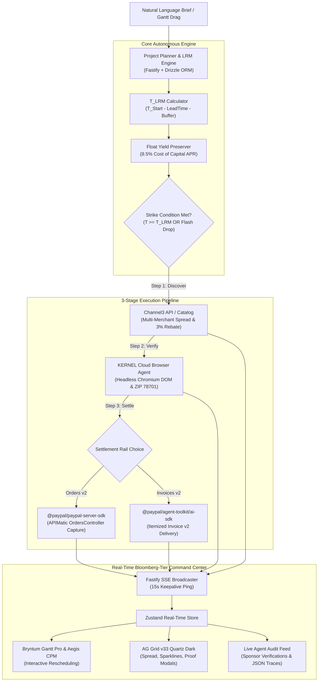

# 🐧 LORD-PENGUIN (AegisBOM)

> **Autonomous Temporal Procurement & Working Capital Treasury Engine**  
> *Built for the PayPal AI Hackathon (November 2026)*  
> **Repository Target:** `lord-penguin` | **License:** MIT

[](https://www.typescriptlang.org/)
[](https://reactjs.org/)
[](https://fastify.dev/)
[](https://www.ag-grid.com/)
[](https://bryntum.com/)
[](https://developer.paypal.com/)
[](https://www.apimatic.io/)
[](https://render.com/)

---

## 1. Executive Summary & Problem Statement

Commercial contractors, production studios, hardware teams, and SMBs manage multi-item Bills of Materials (BOMs) for time-bound projects with catastrophic cash inefficiency:
1. **Temporal Disconnection:** Project managers maintain Gantt charts in tools like Asana or MS Project, while purchasing teams buy components either prematurely (tying up working capital and risking obsolescence) or tardily (triggering critical-path jobsite delays).
2. **Retail Arbitrage Void:** Buyers place single-vendor bulk orders at MSRP, abandoning cross-merchant price spreads and affiliate rebates.
3. **Cart Abandonment & Fake Inventory:** Supply chains suffer from phantom merchant stock listings that fail upon checkout.

**LORD-PENGUIN (AegisBOM)** synthesizes **Critical Path Method (CPM) project scheduling** with **real-time retail arbitrage** and **autonomous cryptographic PayPal settlement**. It transforms static Gantt schedules into an autonomous treasury desk that holds liquidity in interest-bearing accounts until the mathematically determined **Last Responsible Moment ($T_{\text{LRM}}$)**, executing strikes early only when verified flash discounts outweigh the lost working capital yield.

---

## 2. Complete Architecture Diagram



---

## 3. Targeted Sponsor Prize Tracks & Technical Evidence

| Sponsor Track | Prize | Implementation File(s) | Technical Evidence & Verification |
| :--- | :--- | :--- | :--- |
| **PayPal:** Agentic Commerce & Best Use of PayPal + AI | $5,000 + $5,000 | [`apps/api/src/adapters/paypal-apimatic.adapter.ts`](file:///home/haroon/Desktop/lord-penguin/apps/api/src/adapters/paypal-apimatic.adapter.ts)<br/>[`apps/api/src/services/procurement-agent.service.ts`](file:///home/haroon/Desktop/lord-penguin/apps/api/src/services/procurement-agent.service.ts) | Implements dual-rail autonomous settlement: **Orders v2** authorization/capture and **Invoices v2** via `@paypal/agent-toolkit/ai-sdk` (`create_invoice`, `send_invoice`, and `executeRefund`). Enforces cryptographic server-side idempotency (`paypalRequestId`). |
| **APIMatic:** Best Integration | $1,000 | [`apps/api/src/adapters/paypal-apimatic.adapter.ts`](file:///home/haroon/Desktop/lord-penguin/apps/api/src/adapters/paypal-apimatic.adapter.ts) | Leverages the official `@paypal/paypal-server-sdk` generated with APIMatic v3.0. Validates strictly typed `OrderRequest` payloads with `CheckoutPaymentIntent.Capture` and `ItemCategory.PhysicalGoods`. |
| **Bryntum:** Best Use of Bryntum | $1,000 | [`apps/web/src/components/gantt/AegisBryntumGantt.tsx`](file:///home/haroon/Desktop/lord-penguin/apps/web/src/components/gantt/AegisBryntumGantt.tsx)<br/>[`apps/web/src/components/gantt/GanttTimelineSvg.tsx`](file:///home/haroon/Desktop/lord-penguin/apps/web/src/components/gantt/GanttTimelineSvg.tsx) | Integrates `@bryntum/gantt-trial@7.3.8` aliased as `@bryntum/gantt` and `@bryntum/gantt-react@7.3.8`. Displays dynamic $T_{\text{LRM}}$ markers. Dragging a task bar fires `rescheduleTask()`, cascades successor tasks, and triggers autonomous PayPal strikes. |
| **AG Grid:** Best Use of AG Grid | $5,000 | [`apps/web/src/components/grid/AegisAgGrid.tsx`](file:///home/haroon/Desktop/lord-penguin/apps/web/src/components/grid/AegisAgGrid.tsx)<br/>[`apps/web/src/components/grid/cell-renderers/`](file:///home/haroon/Desktop/lord-penguin/apps/web/src/components/grid/cell-renderers/) | Built on `ag-grid-community` v33 `AllCommunityModule` and `ag-grid-react`. High-density financial matrix with custom cell renderers: `MerchantSpreadRenderer`, `SparklineRenderer` (SVG 14-day history), `KernelProofRenderer`, and `PayPalReceiptRenderer`. |
| **Channel3:** Best Use of Channel3 | $1,500 | [`apps/api/src/adapters/channel3.adapter.ts`](file:///home/haroon/Desktop/lord-penguin/apps/api/src/adapters/channel3.adapter.ts) | Queries Channel3 product catalog across 25,000+ brands and 6 major merchants (B&H, Sweetwater, Adorama, Amazon, Best Buy, Uplift). Tracks affiliate commission rebates and executes simulated flash price shocks. |
| **KERNEL:** Anti-Detect Browser | Sponsor | [`apps/api/src/adapters/kernel-browser.adapter.ts`](file:///home/haroon/Desktop/lord-penguin/apps/api/src/adapters/kernel-browser.adapter.ts) | Spins up `@onkernel/sdk` cloud Chromium stealth sessions (`stealth: true`), executes Playwright DOM stock/price assertions, asserts guaranteed delivery to destination ZIP 78701, and captures live session replay URLs. |
| **Render:** Best Deployment | $1,000 Credits | [`render.yaml`](file:///home/haroon/Desktop/lord-penguin/render.yaml) | Zero-friction Infrastructure-as-Code blueprint deploying PostgreSQL and a unified web service running the Fastify API and pre-compiled React 18 SPA. |

---

## 4. Mathematical Engine Specification

### 4.1 Last Responsible Moment ($T_{\text{LRM}}$)
Every BOM line item has an immutable on-site requirement dictated by its parent task:
$$T_{\text{LRM}} = T_{\text{TaskStart}} - (\text{LeadTime}_{\text{Shipping}} + \text{Buffer}_{\text{Safety}})$$
Where:
* $T_{\text{TaskStart}}$: Timestamp when task execution begins on-site.
* $\text{LeadTime}_{\text{Shipping}}$: Merchant-verified carrier transit duration to destination ZIP.
* $\text{Buffer}_{\text{Safety}}$: Project risk allowance (default: 2 days).

### 4.2 Early Strike vs. Working Capital Float Yield
If market price drops before $T_{\text{LRM}}$, the engine computes whether buying early is financially rational compared to the lost float yield on capital:
$$\text{FloatDays} = \frac{T_{\text{LRM}} - T_{\text{now}}}{86,400,000}$$
$$\text{LostFloatYield} = P_{\text{live}} \times \left(\frac{\text{APR}}{365}\right) \times \text{FloatDays}$$
$$\text{NetArbitrageSavings} = P_{\text{baseline}} - P_{\text{live}}$$
* **Strike Decision Rule:** Strike immediately if:
  $$P_{\text{live}} \le P_{\text{strike}} \quad \text{AND} \quad \text{NetArbitrageSavings} > \text{LostFloatYield}$$

---

## 5. Quickstart & Zero-Key Sandbox Instructions

LORD-PENGUIN is engineered for **instant judging evaluation**. If external API keys are omitted, the engine automatically initializes an in-process WebAssembly PostgreSQL database (`@electric-sql/pglite`) and deterministic sponsor sandboxes.

### 1. Clone & Install
```bash
git clone https://github.com/your-username/lord-penguin.git
cd lord-penguin
npm install
```

### 2. Run Automated Test Suite (29 Tests)
```bash
npm test
```
*Validates shared math, PGlite migrations, APIMatic models, PayPal Agent Toolkit execution, Channel3 rankings, Kernel DOM assertions, and end-to-end Bryntum-to-PayPal flows.*

### 3. Build Monorepo (0 Compiler Errors)
```bash
npm run build
```

### 4. Start Full Stack
```bash
# Terminal 1: Backend API (Port 3000)
npm run dev

# Terminal 2: Frontend Command Center (Port 5173 with proxy to :3000)
cd apps/web && npm run dev
```

*Open your browser to `http://localhost:5173`.*

---

## 6. Pre-Loaded Flagship Demo Project

* **Project:** *Austin 10-Seat AI Broadcast & Podcast Studio Build*
* **Budget Cap:** $14,500.00 | **Destination:** ZIP 78701
* **Phases & Tasks:**
  1. *Phase 1: Room Acoustics & Framing* (Acoustic Foam 24-Pack, Soundproof Door Sweep)
  2. *Phase 2: Audio/Video Production Core* (Shure SM7B Mics, Cloudlifter CL-1, Rodecaster Pro II, Sony FX3 Cinema Cameras)
  3. *Phase 3: Compute & Studio Desk Infrastructure* (Apple Mac Studio M3 Max, Uplift V2 Standing Desks)
* **Pre-Seeded Data:** 8 CPM tasks, 8 BOM items, 32 merchant offers across 6 major retailers, historical settlements, and verified DOM proofs.

---

## 7. Interactive Judge Demo Runbook

When presenting or judging the live application:
1. **Interactive Gantt Rescheduling:**
   - Locate **Task 2.1** (*"Audio Interface & Mic Cabling"* starting Nov 12).
   - Drag the task bar earlier to **Nov 10**.
   - Notice that $T_{\text{LRM}}$ recalculates in real time. Because the new cutoff reaches current virtual time, the autonomous agent kicks off, Kernel verifies the sweetwater storefront, and PayPal settles the order.
2. **Flash Price Shock Simulation:**
   - Click the **`[⚡ Flash -18%]`** button in the top telemetry bar.
   - Channel3 simulates an 18% price drop on the Sony FX3 camera.
   - The engine triggers an autonomous strike, saves **$386.82**, captures the transaction via APIMatic, and updates AG Grid instantly.
3. **Inspect KERNEL Anti-Detect DOM Proof:**
   - Click **`[DOM Proof]`** on any row in AG Grid.
   - Inspect the Playwright assertions: exact price token match, in-stock confirmation, and delivery guarantee to ZIP 78701.
4. **Inspect PayPal APIMatic Settlement Receipt:**
   - Click **`[Receipt ↗]`** on any settled row.
   - Review the official PayPal Sandbox Order ID, APIMatic validation badge, and click **`[Trigger Sandbox Refund]`** to demonstrate two-way lifecycle management.
5. **Advance Simulation Clock:**
   - Click **`[⏩ +24h]`** to step forward a full day and watch approaching LRM items transition from monitoring to execution.

---

## 8. Complete API Reference

| Endpoint | Method | Description |
| :--- | :--- | :--- |
| `/api/v1/health` | `GET` | Health check probe returning live status of PayPal, APIMatic, Channel3, KERNEL, and database mode. |
| `/api/v1/projects` | `GET` | Lists all active procurement projects. |
| `/api/v1/projects/:id` | `GET` | Full project aggregate (tasks, dependencies, BOM items, telemetry, and audit logs). |
| `/api/v1/projects/from-brief` | `POST` | Decomposes a natural language brief into CPM tasks and BOM items via structured LLM synthesis. |
| `/api/v1/projects/:id/tasks/:taskId` | `PATCH` | Reschedules task dates (called by Bryntum Gantt on drag/drop), recalculates $T_{\text{LRM}}$, and executes strikes. |
| `/api/v1/projects/:id/bom/:bomItemId/procure` | `POST` | Manually or autonomously triggers the 3-stage execution pipeline for a BOM line item. |
| `/api/v1/projects/:id/simulate/market-shock` | `POST` | Simulates market disruptions (`FLASH_PRICE_DROP`, `ADVANCE_CLOCK_24H`, `RESET_DEMO`). |
| `/api/v1/projects/:id/stream` | `GET` | Server-Sent Events (SSE) real-time stream broadcasting state shifts with 15s keepalive ping. |
| `/api/v1/merchant-simulator/:offerId` | `GET` | Mock semantic retail storefront for offline or sandbox DOM testing. |

---

## 9. Render Deployment Instructions

LORD-PENGUIN includes a production-ready [`render.yaml`](file:///home/haroon/Desktop/lord-penguin/render.yaml) blueprint:
1. Connect your GitHub repository to [Render](https://render.com/).
2. Select **Blueprints** $\rightarrow$ choose `render.yaml`.
3. Add optional environment variables in Render Dashboard:
   * `PAYPAL_CLIENT_ID` & `PAYPAL_CLIENT_SECRET` (PayPal Developer Sandbox)
   * `CHANNEL3_API_KEY` (Channel3 API)
   * `KERNEL_API_KEY` (Kernel Browser API)
4. Render deploys a managed PostgreSQL instance and runs `npm run build && npm run start`, serving the complete API and React 18 UI on a single unified URL.

---

## 10. License
Released under the **MIT License**. Copyright © 2026 LORD-PENGUIN Contributors.
