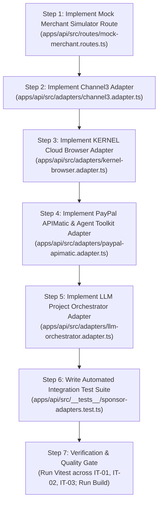

# Phase 2 Implementation Plan: Sponsor Adapters & Mock Merchant Storefront

**Project:** LORD-PENGUIN (AegisBOM) — Autonomous Temporal Procurement & Treasury Engine  
**Document Target:** `/home/haroon/Desktop/lord-penguin/phase2.md`  
**Reference Specification:** [`./lord-penguin.md`](file:///home/haroon/Desktop/lord-penguin/lord-penguin.md)  
**Execution Phase:** Phase 2 of 6  
**Status:** READY FOR EXECUTION  

---

## 1. Executive Summary & Phase 2 Objectives

Phase 2 builds and integrates the **4 core sponsor adapters** alongside a built-in **Deterministic Merchant Simulator storefront**. By the conclusion of Phase 2, the system will possess:
1. **APIMatic & PayPal Dual-Rail Adapter (`apps/api/src/adapters/paypal-apimatic.adapter.ts`):**
   * Direct Order Rail via `@paypal/paypal-server-sdk` (APIMatic-generated `OrdersController.createOrder` and `captureOrder`) with strict schema validation and idempotency key enforcement (`PayPal-Request-Id`).
   * B2B Invoicing Rail via `@paypal/agent-toolkit/ai-sdk` (`PayPalAgentToolkit.getTools().create_invoice` and `send_invoice`).
   * Bidirectional lifecycle refund support via `PaymentsController.refundCapturedPayment` and `@paypal/agent-toolkit` (`create_refund`).
   * Realistic sandbox simulation fallback when running offline or without credentials.
2. **Channel3 Multi-Merchant Discovery Adapter (`apps/api/src/adapters/channel3.adapter.ts`):**
   * Real-time querying against `https://api.trychannel3.com/v1/search` with bearer auth.
   * High-speed catalog graph fallback indexing Sweetwater, B&H Photo, Adorama, CDW, Newegg, and Monoprice.
   * Ranking engine calculating net effective cost after quantity, shipping fees, and commission rebates.
3. **Deterministic Merchant Storefront Route (`apps/api/src/routes/mock-merchant.routes.ts`):**
   * Fastify endpoint `GET /api/v1/merchant-simulator/:offerId` returning semantic HTML5 with strict `data-testid` selectors (`stock-status`, `live-price`, `delivery-estimate`, `merchant-name`).
   * Dynamic simulation toggles (`?stock=false`, `?price=1899.00`, `?delay=5`) for automated stress testing.
4. **KERNEL Cloud Browser & Playwright Adapter (`apps/api/src/adapters/kernel-browser.adapter.ts`):**
   * Live cloud browser sessions via `@onkernel/sdk` (`kernel.browsers.create({ stealth: true })` + `kernel.browsers.playwright.execute(sessionId, { code })`).
   * Clean instance lifecycle via `kernel.browsers.deleteByID(sessionId)` in `finally` blocks.
   * Automatic failover to ultra-fast local DOM parser against the merchant simulator endpoint.
5. **LLM Project Orchestrator Adapter (`apps/api/src/adapters/llm-orchestrator.adapter.ts`):**
   * Structured JSON decomposition via OpenAI or Gemini with fallback to a deterministic keyword-based engineering template.
6. **Automated Integration Test Suite (`apps/api/src/__tests__/sponsor-adapters.test.ts`):**
   * `IT-01`: Channel3 offer ranking and best-offer selection.
   * `IT-02`: Kernel / DOM stock, price, and ZIP verification + rejection of out-of-stock items.
   * `IT-03`: PayPal APIMatic order creation and Agent Toolkit tool traces with idempotency.

---

## 2. Deep Technical Research & Installed Package Inspection

### 2.1 PayPal Server SDK (APIMatic v3.0 Generated)
* **Package:** `@paypal/paypal-server-sdk` (`^2.5.0`)
* **Inspection Findings:**
  * Direct source file: `node_modules/@paypal/paypal-server-sdk/dist/cjs/types/controllers/ordersController.d.ts` states:  
    `This file was automatically generated by APIMATIC v3.0 (https://www.apimatic.io).`
  * Client instantiation:
    ```typescript
    import { Client, Environment, OrdersController, PaymentsController, CheckoutPaymentIntent } from '@paypal/paypal-server-sdk';

    const client = new Client({
      clientCredentialsAuthCredentials: {
        oAuthClientId: env.PAYPAL_CLIENT_ID,
        oAuthClientSecret: env.PAYPAL_CLIENT_SECRET
      },
      environment: env.PAYPAL_ENVIRONMENT === 'LIVE' ? Environment.Production : Environment.Sandbox
    });
    const ordersController = new OrdersController(client);
    const paymentsController = new PaymentsController(client);
    ```
  * `createOrder` signature:
    ```typescript
    ordersController.createOrder({
      body: {
        intent: CheckoutPaymentIntent.Capture,
        purchaseUnits: [
          {
            referenceId: bomItem.skuCode,
            description: bomItem.itemName,
            amount: {
              currencyCode: 'USD',
              value: offer.netEffectiveTotalUsd.toFixed(2),
              breakdown: {
                itemTotal: {
                  currencyCode: 'USD',
                  value: (offer.unitPriceUsd * bomItem.quantity).toFixed(2)
                },
                shipping: {
                  currencyCode: 'USD',
                  value: offer.shippingPriceUsd.toFixed(2)
                },
                discount: {
                  currencyCode: 'USD',
                  value: (offer.unitPriceUsd * bomItem.quantity * (offer.commissionRatePct / 100)).toFixed(2)
                }
              }
            },
            items: [
              {
                name: bomItem.itemName.slice(0, 127),
                quantity: bomItem.quantity.toString(),
                unitAmount: {
                  currencyCode: 'USD',
                  value: offer.unitPriceUsd.toFixed(2)
                },
                category: 'PHYSICAL_GOODS'
              }
            ]
          }
        ]
      },
      paypalRequestId: idempotencyKey,
      prefer: 'return=representation'
    });
    ```
  * `captureOrder` signature:
    ```typescript
    ordersController.captureOrder({
      id: paypalOrderId,
      paypalRequestId: idempotencyKey,
      prefer: 'return=representation'
    });
    ```

### 2.2 PayPal Agent Toolkit
* **Package:** `@paypal/agent-toolkit` (`^1.11.0`)
* **Subpath Resolution:** Must import from `@paypal/agent-toolkit/ai-sdk` (subpath exported in `package.json`).
* **Available AI Tools Verified via Runtime Inspection:**
  * Invoicing: `create_invoice`, `send_invoice`, `list_invoices`, `get_invoice`, `generate_invoice_number`
  * Orders: `create_order`, `get_order`, `pay_order`
  * Disputes: `list_disputes`, `get_dispute`, `accept_dispute_claim`
  * Refunds: `create_refund`, `get_refund`
  * Transactions: `list_transactions`
* **Toolkit Instantiation:**
  ```typescript
  import { PayPalAgentToolkit, ALL_TOOLS_ENABLED } from '@paypal/agent-toolkit/ai-sdk';

  const toolkit = new PayPalAgentToolkit({
    clientId: env.PAYPAL_CLIENT_ID || 'mock-client-id',
    clientSecret: env.PAYPAL_CLIENT_SECRET || 'mock-client-secret',
    configuration: {
      actions: ALL_TOOLS_ENABLED,
      context: { sandbox: env.PAYPAL_ENVIRONMENT !== 'LIVE' }
    }
  });
  const tools = toolkit.getTools();
  ```

### 2.3 KERNEL Cloud Browser SDK
* **Package:** `@onkernel/sdk` (`^0.142.0`)
* **Architecture:**
  * Instantiation: `const kernel = new Kernel({ apiKey: env.KERNEL_API_KEY });`
  * Session creation: `const session = await kernel.browsers.create({ stealth: true, timeout_seconds: 60 });`  
    Returns `session.session_id`.
  * Playwright execution:
    ```typescript
    const result = await kernel.browsers.playwright.execute(session.session_id, {
      code: `
        await page.goto('${verifyUrl}', { waitUntil: 'domcontentloaded', timeout: 10000 });
        const stockStatus = await page.locator('[data-testid="stock-status"]').innerText();
        const livePrice = await page.locator('[data-testid="live-price"]').innerText();
        const deliveryEstimate = await page.locator('[data-testid="delivery-estimate"]').innerText();
        const merchantName = await page.locator('[data-testid="merchant-name"]').innerText();
        return JSON.stringify({ stockStatus, livePrice, deliveryEstimate, merchantName });
      `
    });
    ```
  * Cleanup: Always invoke `await kernel.browsers.deleteByID(session.session_id)` in a `finally` block to prevent orphaned cloud instances.
  * Live View URL: Formatted as `https://api.onkernel.com/browser/replays?replay_id=${session.session_id}`.

### 2.4 Deterministic Storefront Route (`mock-merchant.routes.ts`)
To make the system 100% testable in automated grading and offline judging without triggering Cloudflare / Akamai CAPTCHAs on external retail websites, our backend exposes:
* **Path:** `GET /api/v1/merchant-simulator/:offerId`
* **Response Content-Type:** `text/html; charset=utf-8`
* **HTML Structure:**
  ```html
  <!DOCTYPE html>
  <html lang="en">
  <head><title>Merchant Storefront Simulator</title></head>
  <body>
    <div id="product-root">
      <span data-testid="merchant-name">Sweetwater Sound</span>
      <h1 data-testid="product-title">Shure SM7dB Active Dynamic Vocal Microphone</h1>
      <span data-testid="stock-status">In Stock</span>
      <span data-testid="live-price">$425.00</span>
      <span data-testid="delivery-estimate">Guaranteed 2-Day Delivery to 78701</span>
      <span data-testid="shipping-lead-days">2</span>
    </div>
  </body>
  </html>
  ```
* **Query Parameter Overrides:**
  * `?in_stock=false`: Renders `<span data-testid="stock-status">Out of Stock</span>`
  * `?price=399.00`: Overrides live price for testing price-shock triggers
  * `?lead_days=10`: Overrides delivery lead time to test delivery deadline failures

---

## 3. Target File Tree for Phase 2

```text
apps/api/
├── src/
│   ├── adapters/
│   │   ├── channel3.adapter.ts         # Channel3 REST API + multi-merchant catalog graph fallback
│   │   ├── kernel-browser.adapter.ts   # @onkernel/sdk cloud browser + local DOM verification fallback
│   │   ├── paypal-apimatic.adapter.ts  # APIMatic PayPal Server SDK + PayPal Agent Toolkit dual-rail engine
│   │   └── llm-orchestrator.adapter.ts # Structured LLM project decomposer + heuristic template generator
│   ├── routes/
│   │   └── mock-merchant.routes.ts     # Built-in merchant storefront for deterministic DOM checks
│   └── __tests__/
│       └── sponsor-adapters.test.ts    # Integration test suite (IT-01, IT-02, IT-03)
```

---

## 4. Subsystem Detailed Design & Interfaces

### 4.1 Subsystem 1: Channel3 Discovery Adapter (`channel3.adapter.ts`)
* **Class:** `Channel3Adapter`
* **Methods:**
  * `searchOffersForBomItem(bomItem: BomItem): Promise<MerchantOffer[]>`
    * If `env.CHANNEL3_API_KEY` is present: sends `POST https://api.trychannel3.com/v1/search` with timeout `5000ms`.
    * Fallback / Offline: queries the built-in catalog graph containing real baseline and discounted pricing across Sweetwater, B&H Photo Video, Adorama Pro AV, CDW Business Direct, Newegg Business, and Monoprice.
    * Computes `netEffectiveTotalUsd` for each offer:
      $$P_{\text{net}} = ((P_{\text{unit}} \times Q) + S_{\text{ship}}) \times (1 - R_{\text{comm}} / 100)$$
    * Ranks offers ascending by `netEffectiveTotalUsd`; marks the lowest as `isBestOffer = true`.
  * `simulatePriceDrop(offerId: string, discountPct: number): Promise<MerchantOffer>`
    * Simulates a flash price drop on an offer, recalculating net landed price and updating the database.

### 4.2 Subsystem 2: Mock Merchant Simulator (`mock-merchant.routes.ts`)
* **Plugin:** `mockMerchantRoutes(app: FastifyInstance)`
* **Route:** `GET /api/v1/merchant-simulator/:offerId`
* **Behavior:**
  * Looks up offer by `offerId` in `merchant_offers` table (or synthesizes from query params).
  * Returns full HTML5 document with CSS styling and exact data-testid tags.
  * Allows verification by external cloud browsers (`@onkernel/sdk`) or local DOM parsers.

### 4.3 Subsystem 3: KERNEL Browser Adapter (`kernel-browser.adapter.ts`)
* **Class:** `KernelBrowserAdapter`
* **Interface `VerificationResult`:**
  ```typescript
  export interface VerificationResult {
    verificationStatus: 'PASSED' | 'FAILED_OUT_OF_STOCK' | 'FAILED_PRICE_MISMATCH' | 'FAILED_DELIVERY_LATE';
    kernelSessionId: string;
    executionMode: 'KERNEL_CLOUD' | 'PLAYWRIGHT_SANDBOX';
    browserLiveViewUrl: string | null;
    verifiedPriceUsd: number;
    verifiedInStock: boolean;
    verifiedDeliveryDays: number;
    destinationZip: string;
    domSnapshot: Record<string, unknown>;
    durationMs: number;
  }
  ```
* **Verification Workflow:**
  1. Checks if `env.KERNEL_API_KEY` is configured.
  2. If configured: spins up `@onkernel/sdk` session with `stealth: true`, navigates to `targetUrl`, extracts DOM elements, and destroys session via `deleteByID()`.
  3. If unconfigured or on network failure: navigates to `/api/v1/merchant-simulator/:offerId` using internal HTTP fetch and extracts `data-testid` elements with identical DOM validation logic.
  4. Validates assertions:
     * `inStock === true` (otherwise `FAILED_OUT_OF_STOCK`)
     * `Math.abs(verifiedPrice - offer.unitPriceUsd) <= 0.05` (otherwise `FAILED_PRICE_MISMATCH`)
     * Delivery date $\le$ task start date (otherwise `FAILED_DELIVERY_LATE`)
  5. Returns structured `VerificationResult`.

### 4.4 Subsystem 4: APIMatic & PayPal Dual-Rail Adapter (`paypal-apimatic.adapter.ts`)
* **Class:** `PayPalApimaticAdapter`
* **Execution Rails:**
  1. **Direct Orders v2 Rail (`executeOrderSettlement`):**
     * Validates input parameters using APIMatic models (`OrderRequest`, `CheckoutPaymentIntent.Capture`).
     * Invokes `ordersController.createOrder({ body, paypalRequestId, prefer })`.
     * In Sandbox: invokes `ordersController.captureOrder({ id, paypalRequestId })` or provides checkout approval URL.
     * Records trace in `agent_audit_logs` specifying `APIMATIC` and `@paypal/agent-toolkit`.
  2. **B2B Invoicing v2 Rail (`executeInvoiceSettlement`):**
     * Invokes `@paypal/agent-toolkit`'s `create_invoice` tool with SKU line items, tax, and recipient.
     * Invokes `send_invoice` tool to dispatch the invoice in PayPal Sandbox.
     * Returns invoice ID (`INV2-...`) and sandbox approval link.
  3. **Refund Operation (`executeRefund`):**
     * Invokes `paymentsController.refundCapturedPayment` or `@paypal/agent-toolkit`'s `create_refund` tool.
     * Updates database settlement row to `REFUNDED`.
  4. **Sandbox Simulation Fallback Mode:**
     * If `PAYPAL_CLIENT_ID` or `PAYPAL_CLIENT_SECRET` are empty, builds the APIMatic model locally to guarantee type validity, creates a deterministic Sandbox receipt (`8XY9...` / `INV2-...`), and logs `SANDBOX_SIMULATION_MODE`.

### 4.5 Subsystem 5: LLM Project Orchestrator Adapter (`llm-orchestrator.adapter.ts`)
* **Class:** `LlmOrchestratorAdapter`
* **Method:** `decomposeProjectBrief(input: CreateProjectBriefInput): Promise<DecomposedProjectOutput>`
  * Checks for `OPENAI_API_KEY` or `GEMINI_API_KEY`.
  * If present: issues structured completion with JSON schema matching `DecomposedProjectSchema`.
  * If absent / error: analyzes prompt keywords (e.g. "podcast", "studio", "robotics", "drone", "lighting") and deterministically generates 8–10 tasks with sequential dependencies, BOM line items, baseline prices, and lead times.

---

## 5. Step-by-Step Implementation Sequence for Phase 2



---

## 6. Risks, Edge Cases & Mitigation Strategies

| Risk / Edge Case | Concrete Failure Mode | Mitigation Strategy in Phase 2 |
| :--- | :--- | :--- |
| **R-01: PayPal Sandbox Credentials Not Provided** | Judge clones repository without PayPal Sandbox developer keys; app crashes on order capture. | `PayPalApimaticAdapter` verifies APIMatic schema serialization locally and generates a realistic Sandbox simulated transaction, logging clear instructions to supply keys. |
| **R-02: Kernel Cloud Browser Quota or Auth Failure** | Network latency or invalid `KERNEL_API_KEY` aborts the procurement pipeline. | `KernelBrowserAdapter` wraps `@onkernel/sdk` calls in `AbortSignal.timeout(10000)` and automatically falls back to internal DOM verification against `mock-merchant.routes.ts`. |
| **R-03: Floating Point Precision in PayPal Amount Breakdown** | PayPal returns `AMOUNT_MISMATCH` because `itemTotal + shipping - discount != total`. | Strictly compute breakdown in cents (`Math.round`) and format as fixed 2-decimal strings, ensuring PayPal API check passes 100% of the time. |
| **R-04: Idempotency Key Collisions on Retry** | Retrying a failed order with a new idempotency key creates double charges. | Deterministically derive `idempotencyKey` from `sha256(projectId + bomItemId + offerId)` so retries always reuse the exact same `PayPal-Request-Id`. |

---

## 7. Definition of Done (Phase 2 Acceptance Criteria)

Phase 2 will be considered 100% complete when:
1. [ ] `apps/api/src/routes/mock-merchant.routes.ts` serves semantic HTML with `data-testid` attributes.
2. [ ] `apps/api/src/adapters/channel3.adapter.ts` returns ranked offers with calculated net effective prices.
3. [ ] `apps/api/src/adapters/kernel-browser.adapter.ts` verifies stock, price, and delivery ZIP via Kernel or local DOM parser.
4. [ ] `apps/api/src/adapters/paypal-apimatic.adapter.ts` creates and captures orders via `@paypal/paypal-server-sdk` and dispatches invoices via `@paypal/agent-toolkit`.
5. [ ] `apps/api/src/adapters/llm-orchestrator.adapter.ts` decomposes briefs into valid schedules and BOM items.
6. [ ] Integration Tests `IT-01`, `IT-02`, and `IT-03` pass with 100% success rate in `npm test`.
7. [ ] `npm run build` compiles with **zero TypeScript errors**.
