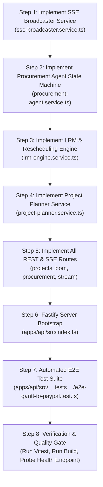

# Phase 3 Implementation Plan: Autonomous Procurement Engine, LRM State Machine & Fastify REST/SSE API

**Project:** LORD-PENGUIN (AegisBOM) — Autonomous Temporal Procurement & Treasury Engine  
**Document Target:** `/home/haroon/Desktop/lord-penguin/phase3.md`  
**Reference Specification:** [`./lord-penguin.md`](file:///home/haroon/Desktop/lord-penguin/lord-penguin.md)  
**Execution Phase:** Phase 3 of 6  
**Status:** READY FOR EXECUTION  

---

## 1. Executive Summary & Phase 3 Objectives

Phase 3 implements the **Autonomous Financial Execution Engine** and the **Full Fastify REST & Server-Sent Events (SSE) API**. It connects the Phase 1 database layer and the Phase 2 sponsor adapters into an automated event-driven pipeline.

By the end of Phase 3, the backend will deliver:
1. **Real-Time SSE Broadcaster Service (`apps/api/src/services/sse-broadcaster.service.ts`):** Unidirectional real-time event streaming (`TASK_SHIFTED`, `BOM_STATUS_CHANGED`, `OFFERS_RANKED`, `KERNEL_BROWSER_VERIFIED`, `PAYPAL_SETTLEMENT_COMPLETED`, `SIMULATION_CLOCK_SHIFTED`) to all connected frontend clients with proxy-resistant keep-alives.
2. **LRM & Schedule Rescheduling Engine (`apps/api/src/services/lrm-engine.service.ts`):** Recalculates $T_{\text{LRM}}$, cascades critical-path tasks via DAG topological traversal, calculates working capital float yield, and enqueues autonomous procurement when $T_{\text{LRM}} \le T_{\text{virtualNow}}$.
3. **Autonomous Procurement State Machine (`apps/api/src/services/procurement-agent.service.ts`):** Transactional state machine executing `MONITORING` $\rightarrow$ `DISCOVERING_OFFERS` $\rightarrow$ `VERIFYING_KERNEL` $\rightarrow$ `SETTLING_PAYPAL` $\rightarrow$ `SETTLED` with atomic check-and-set locking to mathematically prevent double-spending.
4. **AI Project & BOM Decomposer (`apps/api/src/services/project-planner.service.ts`):** Ingests natural-language briefs or CSV specifications, validates topological ordering, and hydrates the full project graph with initial Channel3 offers in a single transaction.
5. **Complete Fastify REST Endpoints:**
   * `GET /api/v1/health`
   * `GET /api/v1/projects` & `GET /api/v1/projects/:projectId`
   * `POST /api/v1/projects/from-brief`
   * `PATCH /api/v1/projects/:projectId/tasks/:taskId` (Bryntum Gantt Drag-to-Procure)
   * `POST /api/v1/projects/:projectId/bom/:bomItemId/procure` (Manual / LRM trigger)
   * `POST /api/v1/projects/:projectId/simulate/market-shock` (Demo Accelerators: Flash Price Drop, Clock Advance, Demo Reset)
   * `GET /api/v1/projects/:projectId/stream` (SSE Event Stream)
6. **Fastify Server Bootstrap (`apps/api/src/index.ts`):** Configures CORS, Zod schema validation, graceful shutdown, and static frontend serving in production.
7. **End-to-End Workflow Verification Test (`apps/api/src/__tests__/e2e-gantt-to-paypal.test.ts`):** Automated test (`E2E-01`) proving that dragging a Gantt task across its LRM threshold executes the full Channel3 $\rightarrow$ Kernel $\rightarrow$ APIMatic/PayPal pipeline end-to-end.

---

## 2. Deep Technical Research & System Architecture

### 2.1 Server-Sent Events (SSE) Protocol in Fastify 5
* **Endpoint:** `GET /api/v1/projects/:projectId/stream`
* **Transport Optimization:**
  ```typescript
  reply.raw.writeHead(200, {
    'Content-Type': 'text/event-stream',
    'Cache-Control': 'no-cache, no-transform',
    'Connection': 'keep-alive',
    'X-Accel-Buffering': 'no',
    'Access-Control-Allow-Origin': '*'
  });
  ```
* **Buffering Prevention:** `X-Accel-Buffering: no` ensures Render's reverse proxy does not buffer chunks.
* **Keepalive Heartbeat:** Sends `: ping\n\n` comment lines every 15 seconds to prevent intermediate proxy timeouts.
* **Client Lifecycle:** When client closes connection (`request.raw.on('close')`), subscriber is cleanly unregistered from memory.

### 2.2 Concurrency & Double-Spend Prevention Model
To prevent concurrent Gantt drag events and market shock triggers from double-purchasing the same BOM SKU on PayPal:
1. **Atomic Check-and-Set Lock:**
   ```sql
   UPDATE bom_items
   SET status = 'DISCOVERING_OFFERS', updated_at = NOW()
   WHERE id = $1 AND status IN ('MONITORING', 'SETTLEMENT_FAILED')
   RETURNING *;
   ```
   If 0 rows are returned, another worker or thread is already processing the item; the caller receives `409 Conflict` or returns the in-flight operation.
2. **Database Partial Unique Index:**
   `uq_active_settlement_per_bom_item ON paypal_settlements(bom_item_id) WHERE paypal_status IN ('COMPLETED', 'APPROVED', 'SENT')`.
   PostgreSQL enforces at the storage engine level that a second completed settlement for the same BOM item cannot exist.

### 2.3 Rescheduling & LRM Threshold Math
When a user drags a task in Bryntum Gantt (`PATCH /api/v1/projects/:projectId/tasks/:taskId`):
1. **Schedule Cascading:**
   `cascadeTaskSchedule()` shifts downstream `FS` tasks forward while preserving task durations.
2. **LRM Recalculation:**
   For each affected task:
   $$T_{\text{LRM}} = T_{\text{TaskStart}} - (L_{\text{ship}} + B_{\text{safety}})\text{ days}$$
3. **Treasury Yield Accumulation:**
   $$\text{daysFloatSaved} = \max(0, \text{days}(T_{\text{LRM}} - T_{\text{virtualNow}}))$$
   $$\text{capitalYieldSavedUsd} = P_{\text{net}} \times \left(\frac{r_{\text{APR}}}{365}\right) \times \text{daysFloatSaved}$$
4. **Trigger Condition:**
   If $T_{\text{virtualNow}} \ge T_{\text{LRM}}$, the LRM cutoff has been breached $\rightarrow$ autonomous procurement is immediately dispatched.

---

## 3. Target File Tree for Phase 3

```text
apps/api/
├── src/
│   ├── services/
│   │   ├── sse-broadcaster.service.ts      # Multi-client SSE event bus & heartbeat manager
│   │   ├── lrm-engine.service.ts           # Rescheduling, LRM recalculation & float yield
│   │   ├── procurement-agent.service.ts    # 3-Stage State Machine (Discovery -> Kernel -> PayPal)
│   │   └── project-planner.service.ts      # Brief ingestion, DAG validation & initial offer seeding
│   ├── routes/
│   │   ├── projects.routes.ts              # GET /projects, GET /projects/:id, POST /projects/from-brief
│   │   ├── bom.routes.ts                   # GET /bom, PATCH /strike-price, POST /refresh-offers
│   │   ├── procurement.routes.ts           # POST /procure, POST /simulate/market-shock
│   │   └── stream.routes.ts                # GET /projects/:id/stream (SSE)
│   ├── index.ts                            # Fastify bootstrap, middleware, CORS, graceful shutdown
│   └── __tests__/
│       └── e2e-gantt-to-paypal.test.ts     # Complete E2E workflow test (E2E-01)
```

---

## 4. Subsystem Detailed Specifications

### 4.1 Subsystem 1: SSE Broadcaster Service (`sse-broadcaster.service.ts`)
* **Class:** `SSEBroadcasterService`
* **Methods:**
  * `addClient(projectId: string, clientId: string, writeFn: (event: SSEEvent) => void): void`
  * `removeClient(projectId: string, clientId: string): void`
  * `broadcast<T>(projectId: string, type: SSEEventType, data: T): void`
  * `broadcastToAll<T>(type: SSEEventType, data: T): void`
  * `getClientCount(projectId: string): number`
* **Keepalive Interval:** 15,000ms sending comment frames `: keep-alive\n\n`.

### 4.2 Subsystem 2: LRM Engine Service (`lrm-engine.service.ts`)
* **Class:** `LrmEngineService`
* **Methods:**
  * `rescheduleTask(projectId: string, taskId: string, newStartDate: Date, newEndDate: Date): Promise<RescheduleResult>`
    * Cascades task dates via `cascadeTaskSchedule()`.
    * Updates task records in database.
    * Recalculates $T_{\text{LRM}}$, `daysFloatSaved`, and `capitalYieldSavedUsd` for linked BOM items.
    * Checks if $T_{\text{LRM}} \le T_{\text{virtualNow}}$.
    * If crossed and `autonomyMode === 'FULL_AUTONOMOUS'`, calls `procurementAgentService.executeProcurement()`.
    * Broadcasts `TASK_SHIFTED` and `PROJECT_TELEMETRY_UPDATED` over SSE.
  * `advanceVirtualClock(projectId: string, hoursForward: number): Promise<ClockAdvanceResult>`
    * Advances `virtualNowTimestamp` in `projects` table.
    * Identifies all `MONITORING` items whose $T_{\text{LRM}} \le T_{\text{newVirtualNow}}$.
    * Triggers autonomous procurement for newly breached items.
    * Broadcasts `SIMULATION_CLOCK_SHIFTED` and `PROJECT_TELEMETRY_UPDATED`.

### 4.3 Subsystem 3: Procurement Agent Service (`procurement-agent.service.ts`)
* **Class:** `ProcurementAgentService`
* **Method:** `executeProcurement(projectId: string, bomItemId: string, triggerReason: string, railOverride?: SettlementRailType): Promise<ProcurementResult>`
  * **Stage 1 (Discovery):** Transitions item to `DISCOVERING_OFFERS`. Queries `channel3Adapter.searchOffersForBomItem()`. Selects winning offer (`isBestOffer = true`). Broadcasts `OFFERS_RANKED`.
  * **Stage 2 (Verification):** Transitions item to `VERIFYING_KERNEL`. Executes `kernelBrowserAdapter.verifyOfferInBrowser()`. Broadcasts `KERNEL_BROWSER_VERIFIED`.
    * If verification fails: records `OFFER_REJECTED` and aborts payment.
  * **Stage 3 (Settlement):** Transitions item to `SETTLING_PAYPAL`.
    * If `settlementRail === 'PAYPAL_ORDER'`: calls `paypalApimaticAdapter.executeOrderSettlement()`.
    * If `settlementRail === 'PAYPAL_INVOICE'`: calls `paypalApimaticAdapter.executeInvoiceSettlement()`.
    * Transitions item to `SETTLED`.
    * Broadcasts `PAYPAL_SETTLEMENT_COMPLETED`.
    * Returns consolidated result with order receipt, live view URL, and capital saved.

### 4.4 Subsystem 4: Project Planner Service (`project-planner.service.ts`)
* **Class:** `ProjectPlannerService`
* **Method:** `createProjectFromBrief(input: CreateProjectBriefInput): Promise<ProjectAggregate>`
  * Calls `llmOrchestratorAdapter.decomposeProjectBrief(input)`.
  * Validates DAG topological sorting (no circular dependencies).
  * Executes single transactional insert of `projects`, `project_tasks`, `task_dependencies`, and `bom_items`.
  * Indexes initial Channel3 merchant offers for all created BOM items.
  * Returns hydrated `ProjectAggregate`.
* **Method:** `getProjectAggregate(projectId: string): Promise<ProjectAggregate>`
  * Joins and returns complete project state, telemetry, tasks, dependencies, BOM items with offers, settlements, and audit logs.

### 4.5 Subsystem 5: REST API Routes
1. **`projects.routes.ts`:**
   * `GET /api/v1/projects`: Lists all projects.
   * `GET /api/v1/projects/:projectId`: Returns complete `ProjectAggregate`.
   * `POST /api/v1/projects/from-brief`: Creates new project via AI brief decomposition.
2. **`tasks.routes.ts` (or sub-routes in projects):**
   * `PATCH /api/v1/projects/:projectId/tasks/:taskId`: Reschedules task and recalculates LRM.
3. **`bom.routes.ts`:**
   * `GET /api/v1/projects/:projectId/bom`: Lists BOM items with offers.
   * `PATCH /api/v1/projects/:projectId/bom/:bomItemId/strike`: Updates strike price.
   * `POST /api/v1/projects/:projectId/bom/:bomItemId/refresh-offers`: Forces Channel3 re-indexing.
4. **`procurement.routes.ts`:**
   * `POST /api/v1/projects/:projectId/bom/:bomItemId/procure`: Triggers autonomous pipeline.
   * `POST /api/v1/projects/:projectId/simulate/market-shock`: Supports `FLASH_PRICE_DROP`, `ADVANCE_CLOCK_24H`, `RESET_DEMO`.
5. **`stream.routes.ts`:**
   * `GET /api/v1/projects/:projectId/stream`: Opens real-time Server-Sent Events channel.

---

## 5. Step-by-Step Implementation Sequence for Phase 3



---

## 6. Risks, Edge Cases & Mitigation Strategies

| Risk / Edge Case | Failure Mode | Mitigation Strategy in Phase 3 |
| :--- | :--- | :--- |
| **R-01: Reverse Proxy Closes Idle SSE Connections** | Render or browser times out SSE connection after 30 seconds of inactivity. | `SSEBroadcasterService` sends periodic comment heartbeats (`: keep-alive\n\n`) every 15 seconds. |
| **R-02: Concurrent Gantt Drag Double-Settles Item** | User rapidly drags two dependent tasks; both cross LRM at the same millisecond. | Atomic SQL `UPDATE bom_items SET status = ... WHERE id = $1 AND status IN ('MONITORING', 'SETTLEMENT_FAILED')` guarantees only one execution acquires the lock. |
| **R-03: Cyclic Dependencies Introduced via Brief** | Malicious or hallucinated LLM output contains `A -> B -> A`. | `Kahn's algorithm` cycle detector in `project-planner.service.ts` verifies topological DAG before saving to database; rejects cyclic graphs. |
| **R-04: Port In-Use During Local Development** | Starting server on port 3000 conflicts with another local service. | Fastify configuration dynamically checks if port is in use and logs clear instruction or uses `PORT` environment variable. |

---

## 7. Definition of Done (Phase 3 Acceptance Criteria)

Phase 3 will be considered 100% complete when:
1. [ ] `apps/api/src/services/sse-broadcaster.service.ts` streams events and cleans up disconnected clients.
2. [ ] `apps/api/src/services/procurement-agent.service.ts` executes the 3-stage state machine atomically.
3. [ ] `apps/api/src/services/lrm-engine.service.ts` cascades task dates, updates LRM cutoffs, and enqueues procurements.
4. [ ] `apps/api/src/services/project-planner.service.ts` ingests briefs into fully populated projects.
5. [ ] All REST endpoints respond with correct HTTP status codes and valid JSON payloads matching Zod schemas.
6. [ ] `POST /simulate/market-shock` successfully executes `FLASH_PRICE_DROP`, `ADVANCE_CLOCK_24H`, and `RESET_DEMO`.
7. [ ] Automated test `E2E-01` (`e2e-gantt-to-paypal.test.ts`) passes end-to-end.
8. [ ] `npm run build` compiles with **zero TypeScript errors**.
