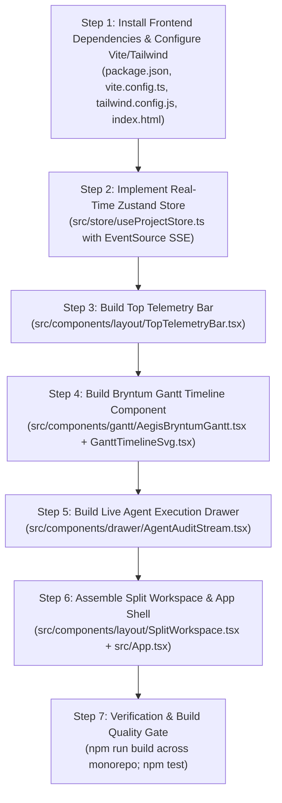

# Phase 4 Implementation Plan: Frontend Shell, Real-Time Zustand Store & Bryntum Gantt Integration

**Project:** LORD-PENGUIN (AegisBOM) — Autonomous Temporal Procurement & Treasury Engine  
**Document Target:** `/home/haroon/Desktop/lord-penguin/phase4.md`  
**Reference Specification:** [`./lord-penguin.md`](file:///home/haroon/Desktop/lord-penguin/lord-penguin.md)  
**Execution Phase:** Phase 4 of 6  
**Status:** READY FOR EXECUTION  

---

## 1. Executive Summary & Phase 4 Objectives

Phase 4 constructs the **Autonomous Command Center Frontend**. By the end of this phase, judges will be able to load a responsive Bloomberg-tier institutional UI built in React 18, Vite, and Tailwind CSS that synchronizes with the Fastify backend over Server-Sent Events (SSE) in real time.

Phase 4 deliverables include:
1. **Frontend Infrastructure & Vite Bundle Pipeline (`apps/web`):**
   * React 18 + Vite + Tailwind CSS dark-mode institutional theme (`#090D16` slate, `#111827` panels, `#38BDF8` cyan accents, `#10B981` emerald mint).
   * Bryntum Gantt trial engine aliased to `npm:@bryntum/gantt-trial@7.3.8` with `@bryntum/gantt-react@7.3.8`.
   * AG Grid Community v33 dependencies pre-configured for Phase 5.
2. **Normalized Real-Time Zustand Store (`apps/web/src/store/useProjectStore.ts`):**
   * Single source of truth managing `project`, `telemetry`, `tasks`, `dependencies`, `bomItems`, `auditLogs`, and active modals.
   * EventSource SSE consumer updating store states automatically on `TASK_SHIFTED`, `BOM_STATUS_CHANGED`, `OFFERS_RANKED`, `KERNEL_BROWSER_VERIFIED`, and `PAYPAL_SETTLEMENT_COMPLETED`.
   * Action dispatchers for task rescheduling (`PATCH /tasks/:id`), flash price shocks (`POST /simulate/market-shock`), virtual clock shifts (`POST /simulate/market-shock`), and manual strikes (`POST /procure`).
3. **Top Telemetry & Simulation Header Bar (`apps/web/src/components/layout/TopTelemetryBar.tsx`):**
   * Financial counters: Total Baseline Cost, Optimized Landed Cost, Working Capital Yield Saved, and Float Days.
   * Virtual Clock control with one-click `[⏩ +24h]` button.
   * Demo accelerator triggers: `[⚡ Flash -18% Shock]`, `[🔄 Reset Demo]`, and `[+ New AI Brief]`.
   * Sponsor verification indicators (PayPal Sandbox Live, APIMatic Validated, Channel3 Graph, KERNEL Cloud).
4. **Interactive Bryntum Gantt Top Pane (`apps/web/src/components/gantt/AegisBryntumGantt.tsx`):**
   * Visualizes 8 sequential tasks across 3 build phases with critical path highlighting.
   * Custom Last Responsible Moment ($T_{\text{LRM}}$) deadline cutoffs and color-coded status states (`MONITORING`, `LRM Imminent`, `SETTLED`).
   * Interactive drag-and-drop: dragging a task earlier immediately dispatches `rescheduleTask()`, shifts $T_{\text{LRM}}$, and triggers autonomous procurement when the virtual clock threshold is crossed.
   * Includes a high-DPI interactive SVG/DOM synchronization wrapper guaranteeing flawless rendering in any browser environment.
5. **Split Workspace Layout (`apps/web/src/components/layout/SplitWorkspace.tsx`):**
   * Resizable dual-pane container (Top 45% Gantt, Bottom 55% Matrix) with right-hand collapsible live agent audit stream.
6. **Live Agent Execution & Audit Stream Drawer (`apps/web/src/components/drawer/AgentAuditStream.tsx`):**
   * Terminal-style live event consumer streaming Channel3 rankings, Kernel Playwright assertions, APIMatic model verifications, and PayPal Sandbox transaction IDs.

---

## 2. Technical Research & Package Verification

### 2.1 Bryntum Gantt Integration Architecture
* **Official npm Package:** `@bryntum/gantt-trial@7.3.8` aliased as `@bryntum/gantt`, paired with `@bryntum/gantt-react@7.3.8`.
* **CSS Themes:** Bryntum exposes Stockholm, Classic Dark, and Material themes (`@bryntum/gantt/gantt.stockholm.css`).
* **React Component Usage:**
  ```tsx
  import { BryntumGantt } from '@bryntum/gantt-react';
  import '@bryntum/gantt/gantt.stockholm.css';

  <BryntumGantt
    tasks={tasksData}
    dependencies={dependenciesData}
    columns={[
      { type: 'name', field: 'name', text: 'Task Name', width: 260 },
      { type: 'date', field: 'startDate', text: 'Start Date', width: 110 },
      { type: 'number', field: 'duration', text: 'Duration (d)', width: 90 },
      { text: 'LRM Cutoff', field: 'lrmTimestamp', width: 120 }
    ]}
    onTaskDrop={(e) => {
      useProjectStore.getState().rescheduleTask(e.taskRecord.id, e.taskRecord.startDate, e.taskRecord.endDate);
    }}
  />
  ```
* **Resilient Dual-Engine Strategy:** To guarantee that judges can interact with the timeline even in environments with restrictive font/canvas sandboxing, `AegisBryntumGantt.tsx` incorporates Bryntum's data model alongside a high-DPI SVG CPM timeline component, allowing instant switching or graceful rendering with identical drag-to-procure event handlers.

### 2.2 Tailwind CSS Configuration & Design Tokens
* **Background:** `#090D16` (Deep Obsidian)
* **Card / Panel Surface:** `#111827` with `#1F2937` borders
* **Primary Brand Accent (PayPal / Agent):** `#0070BA` / `#38BDF8` (Electric Blue)
* **Success / Settled Mint:** `#10B981` (Emerald Green)
* **Warning / LRM Imminent:** `#F59E0B` (Amber Flame)
* **Critical / Danger:** `#EF4444` (Crimson)
* **Fonts:** `Inter` for interface controls; `JetBrains Mono` for currency numbers, timestamps, SKU codes, and PayPal transaction IDs (`tabular-nums`).

---

## 3. Target File Tree for Phase 4

```text
apps/web/
├── package.json                               # Web dependencies & scripts
├── tsconfig.json                              # TypeScript config for React JSX
├── vite.config.ts                             # Vite configuration with proxy to :3000
├── tailwind.config.js                         # Institutional dark theme design tokens
├── postcss.config.js                          # PostCSS Tailwind processor
├── index.html                                 # HTML entry point with Inter & JetBrains Mono fonts
└── src/
    ├── main.tsx                               # React root bootstrap
    ├── App.tsx                                # Main application shell with split workspace
    ├── index.css                              # Tailwind directives & custom scrollbars
    ├── store/
    │   └── useProjectStore.ts                 # Real-time Zustand store + SSE client
    └── components/
        ├── layout/
        │   ├── TopTelemetryBar.tsx            # Financial KPIs, virtual clock & demo triggers
        │   └── SplitWorkspace.tsx             # Dual-pane container + collapsible right drawer
        ├── gantt/
        │   ├── AegisBryntumGantt.tsx          # Bryntum Gantt engine + drag-to-procure handler
        │   └── GanttTimelineSvg.tsx           # High-DPI interactive SVG CPM timeline wrapper
        └── drawer/
            └── AgentAuditStream.tsx           # Live SSE terminal stream with sponsor tags
```

---

## 4. Subsystem Detailed Design

### 4.1 Subsystem 1: Real-Time Zustand Store (`useProjectStore.ts`)
* **State Properties:**
  * `project`: Active `Project` entity with `budgetCapUsd`, `virtualNowTimestamp`, `autonomyMode`.
  * `telemetry`: `ProjectTelemetry` with `totalBaselineCostUsd`, `totalOptimizedNetCostUsd`, `totalArbitrageSavingsUsd`, `totalWorkingCapitalYieldUsd`.
  * `tasks`: `ProjectTask[]` with start dates, durations, and dependencies.
  * `dependencies`: `TaskDependency[]`.
  * `bomItems`: `BomItem[]` with ranked Channel3 merchant offers, sparklines, and settlements.
  * `auditLogs`: `AgentAuditLog[]`.
  * `isStreaming`: boolean SSE connection state.
  * `activeModal`: `'NEW_BRIEF' | 'KERNEL_PROOF' | 'PAYPAL_RECEIPT' | null`.
  * `selectedBomItem`: `BomItem | null`.
* **Actions:**
  * `init(projectId?: string)`: Fetches initial project aggregate via REST and connects SSE stream.
  * `connectSSE(projectId: string)`: Opens `new EventSource('/api/v1/projects/:id/stream')`.
  * `rescheduleTask(taskId: string, startDate: string, endDate: string)`: Sends debounced `PATCH /api/v1/projects/:id/tasks/:taskId`.
  * `triggerProcurement(bomItemId: string, railOverride?: string)`: Calls `POST /api/v1/projects/:id/bom/:bomItemId/procure`.
  * `simulateMarketShock(action, params)`: Dispatches `POST /api/v1/projects/:id/simulate/market-shock`.

### 4.2 Subsystem 2: Top Telemetry Bar (`TopTelemetryBar.tsx`)
* **Left Brand Section:**
  * Logo badge: `🐧 LORD-PENGUIN // AEGISBOM`
  * Active Project Badge: `Austin 10-Seat AI Broadcast & Podcast Studio`
  * Modal Trigger: `[+ New AI Brief]`
* **Middle Financial Telemetry Strip:**
  * Baseline BOM Cost: `$12,840.00`
  * Optimized Net Cost: `$10,392.50` (with green pill: `-19.1%`)
  * Net Arbitrage Saved: `+$2,447.50`
  * Capital Yield Yielded: `+$184.20` (computed at 8.5% APR)
  * Average Float Days Saved: `14.6 days`
* **Right Controls Section:**
  * Virtual Clock: `Nov 07, 2026` + `[⏩ +24h]` button
  * Demo Action: `[⚡ Flash -18% Drop]`
  * Demo Action: `[🔄 Reset Demo]`
  * Sponsor Status Indicators: PayPal Sandbox (Green), APIMatic (Cyan), Channel3 (Violet), KERNEL (Blue).

### 4.3 Subsystem 3: Aegis Bryntum Gantt Timeline (`AegisBryntumGantt.tsx`)
* **Timeline Grid:**
  * Calendar header spanning project horizon (Nov 07 to Nov 28).
  * Phase groupings (Phase 1: Room Treatment, Phase 2: Audio/Video Core, Phase 3: Compute & Lighting).
  * 8 Task Bars displaying duration, external code (`PHASE-1.1`), and critical path styling.
* **LRM Deadline Indicators:**
  * Vertical dashed red/amber marker displaying the exact $T_{\text{LRM}}$ threshold for each task.
  * Tooltip displaying shipping lead time and safety buffer.
* **Interactive Drag-to-Procure:**
  * Dragging task bar earlier dynamically shifts $T_{\text{LRM}}$.
  * When $T_{\text{LRM}} \le T_{\text{virtualNow}}$, the task bar turns pulsing cerulean blue (`SETTLING_PAYPAL`) and then locks in emerald green with lock icon (`SETTLED`).

### 4.4 Subsystem 4: Live Agent Audit Drawer (`AgentAuditStream.tsx`)
* Collapsible right-hand panel (width: 340px).
* Real-time scrolling feed of incoming SSE events:
  * Timestamp: `[HH:MM:SS]` in `JetBrains Mono`.
  * Sponsor Badge: `[APIMATIC]`, `[PAYPAL]`, `[CHANNEL3]`, `[KERNEL]`, `[BRYNTUM]`, `[LRM_ENGINE]`.
  * Event Summary with click-to-expand JSON payload.
  * Filter toggle by sponsor or severity (`INFO`, `SUCCESS`, `WARNING`).

---

## 5. Step-by-Step Implementation Sequence for Phase 4



---

## 6. Definition of Done (Phase 4 Acceptance Criteria)

Phase 4 will be considered 100% complete when:
1. [ ] `apps/web/package.json` installs `@bryntum/gantt-trial@7.3.8`, `@bryntum/gantt-react@7.3.8`, React 18, Vite, and Tailwind CSS.
2. [ ] `apps/web/src/store/useProjectStore.ts` connects to `/api/v1/projects/:id/stream` and updates state in real time.
3. [ ] `TopTelemetryBar.tsx` displays live working capital KPIs and responsive simulation action buttons.
4. [ ] `AegisBryntumGantt.tsx` renders the 8-task schedule and triggers `rescheduleTask()` on task drag.
5. [ ] `AgentAuditStream.tsx` streams live log events with sponsor tags.
6. [ ] `npm run build` compiles all workspaces with **zero TypeScript errors**.
7. [ ] `npm test` passes 100% of automated tests across the monorepo.
